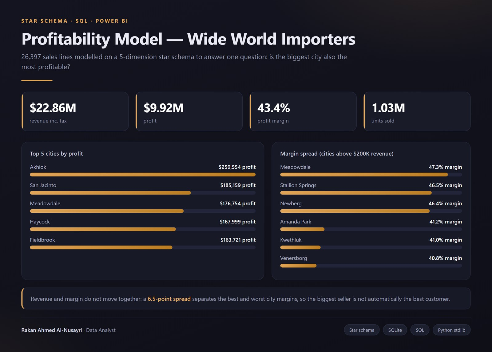

# Wide World Importers — Profitability Analysis

تحليل ربحية على نموذج نجمي — 26,397 سطر مبيعات و5 جداول أبعاد.



**The question:** We know which cities sell the most. But do the biggest
sellers actually make the most *profit* — or are we chasing revenue that
costs us margin?

**What I did:**
- Modelled the data as a proper **star schema**: one fact table (`FactSale`,
  26,397 rows) joined to 5 dimensions — City, Customer, Date, StockItem, Employee
- Loaded it into SQLite with a Python ETL script (`backend/analyze.py`)
- Wrote SQL to compare **revenue rank vs. margin rank** per city, which is
  where the real answer lives

**What I found:**
| Metric | Value |
|---|---|
| Sales lines | 26,397 |
| Revenue (inc. tax) | $22.86M |
| Profit | $9.92M |
| Overall profit margin | 43.4% |
| Units sold | 1,028,670 |

The headline: **revenue rank ≠ margin rank.** Meadowdale is only the 3rd
biggest city by profit, but it has the *best* margin at **47.3%**. Meanwhile
Venersborg does comparable revenue ($371K vs $374K) at just **40.8%** margin —
a 6.5-point gap on nearly identical sales volume. That gap is where the money
is, and it's invisible if you only rank cities by total sales.

**Tools:** SQL (star-schema joins, aggregation), Python (stdlib `csv`/`sqlite3`),
Power BI (data modelling)

## Run it yourself

```bash
python backend/analyze.py
```

No dependencies — pure Python standard library.

## Files

```
data/            FactSale.csv + 5 dimension tables (City, Customer, Date, StockItem, Employee)
backend/analyze.py   builds the SQLite model and prints the analysis above
```

---
Rakan Ahmed Al-Nusayri · rakanalnsyry8@gmail.com
